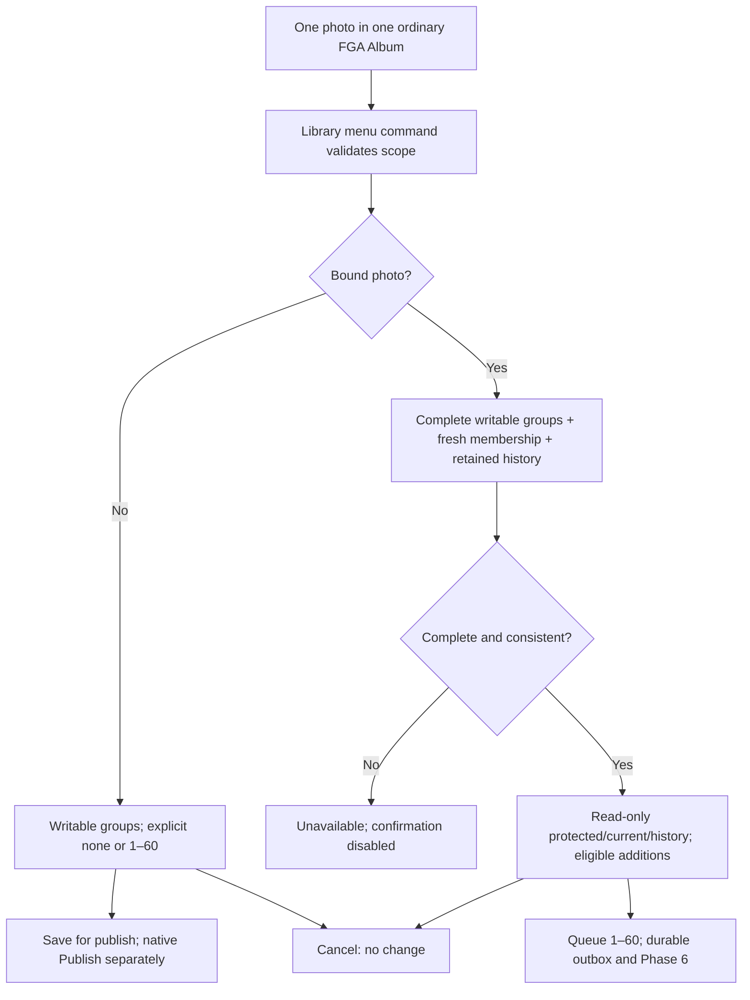

# Photo group selection preview — ticket #0027

Current host follow-up: [actual-host selection evidence](../evidence/lrc15-selection-preview-host-2026-10-15.md). The original source-only verification narrative below is historical; fixture installation and bounded native checks subsequently occurred. Owner interaction approval remains pending.

Copyright 2026 Terry Ott. MIT License.

Review artifact dated 2026-10-15. No #0024/#0026 production selection behavior
is implemented or approved by this prototype. Terry must review the native
interaction and this storyboard before production selection implementation.

The separately named bundle is
`clients/lightroom/prototypes/FGA-LrC15-SelectionPreview.lrplugin` with toolkit
identifier `com.sixbuckssolutions.flickrgroupaddr.lrc15.selectionpreview`.
Install it explicitly through Plug-in Manager; keep the production
`FGA-LrC15.lrplugin` path intact. This preview has no installer, catalog writes,
credential reads, API requests, file persistence, or group submissions.

Authority: accepted architecture ADR 0045, zero-state-publish-flow Phase 4,
existing-public-photo-intake, and moderator-safety-ui-conformance in
`C:\Projects\FGA\architecture-design\docs`. Local primary SDK reference:
15.3 build `202604090947-8f3672ed`, `API Reference/modules/LrDialogs.html`,
`LrView.html`, `LrBinding.html`, `LrFunctionContext.html`, `LrTasks.html`,
`LrPathUtils.html`, and `SDK - Plug-in structure.html`. The native hierarchy uses
documented modal/action binding, radio buttons, checkboxes, popup menu, static
text, edit field, row/column, and scrolled view. No Adobe sample code is copied.

Current host acceptance target is **Lightroom Classic 15.6 Release / Camera Raw
18.7 / build 202609251514-f839cde9**, confirmed by Terry with an installed-host
screenshot on 2026-10-15. Historical 15.5/15.5.1 observations do not qualify this
preview for the current host. The bundle remains major-specific `FGA-LrC15`.
Terry also reconfirmed the Adobe Developer Console's latest SDK as **15.3
(April 2026)** with a screenshot on 2026-10-15; the SDK/host version difference
is intentional.

## Annotated storyboard

| Frame | Native interaction and expected meaning |
| --- | --- |
| 1. Enter from Library | Production: select exactly one photo in one ordinary FGA Album, then Library > Plug-in Extras > FlickrGroupAddr: Choose Group Additions…. Invalid photo/source/service/membership scope produces corrective guidance without opening selection. Preview: choose a synthetic photo/Album fixture from its clearly labeled menu command; no catalog scope is inspected. |
| 2. Establish context | Photo filename/title, Album and scope remain at the top while choosing. Names are context only; service/collection/photo IDs own the scope. The existing-public fixture instead shows its binding and no Album attachment. |
| 3. Unpublished photo | “Not yet published by this FGA collection”; no current-membership inference or request. Choose “No group additions” or “Add to selected groups.” None clears selected boxes; checking a group selects the groups mode. Zero in groups mode and more than 60 disable Save for publish. |
| 4. Scan additions | 376 synthetic writable groups, sorted by display name with exact IDs beside every checkbox. Bound fixtures exclude four protected/current/existing-intent pairs, leaving 372 eligible checkboxes. Search name or ID with Apply search; hidden selections remain included in the always-visible count. Clear the query and apply to restore the full list. Duplicate-looking names remain distinct by ID. No select-all encourages accidentally exceeding 60. |
| 5. Bound photo | Timestamped read-only current membership and retained intent/protection rows appear separately from additions. A moderation-protected pair also has later observed membership; both facts remain visible. Permanent uncertainty copy directs manual inspection without a resubmission control. Only eligible first additions have checkboxes. Queue selected additions requires 1–60. |
| 6. Unavailable and empty | Loading, stale, unavailable and contradictory fixtures disable the complete action and show no partial eligible rows. Stale state is explicitly diagnostic. Empty is a complete zero-row success, distinct from unavailable. Reopen a complete fixture to simulate successful refresh; this preview performs no asynchronous read. |
| 7. Confirm or cancel | Preview confirms only into a transient summary, then discards choices. Cancel and window close produce no summary or durable change. Production unpublished save would return to the host; the user separately invokes the Album's ordinary Publish. Production bound selection would snapshot the local outbox and enter Phase 6 without render/upload. No empty bound batch. |
| 8. Existing public intake | The existing-photo fixture starts after advisory discovery and fresh ownership/public/link-revision proof. Production must repeat proof immediately before missing-intent handoff (15-second proof maximum); stale proof is not authority. No render, upload, replace, attach, catalog binding, or Album mutation belongs to this queue-only path. Discovery and proof are annotated prerequisites, not simulated hosted implementations. |

## Review acceptance checklist

- [ ] Terry opens the separate preview bundle on the confirmed 15.6 host;
  production entry/path remains separate. Record screenshot, host build and date.
- [ ] Photo/Album context is sufficient to prevent choosing for the wrong photo;
  evaluate whether a catalog-derived preview thumbnail is needed in production.
  This fixture deliberately uses textual photo context, with no catalog access.
- [ ] Native dialog fits the current display and resizes usefully. Test narrow
  width, long group labels, keyboard focus, checkbox Space, radio arrows,
  Apply search, Enter and Escape. Check scroll visibility and wrapped protection copy.
- [ ] With all 376 synthetic groups, name/ID search, alphabetical scan, exact-ID
  discrimination and the hidden-selection count are usable. Explicitly approve
  or revise the Apply search/reopen interaction before implementing it.
- [ ] None is confirmable only for unpublished photos; groups mode requires
  1–60, 61 disables; switching to none clears marks. Bound zero stays disabled.
- [ ] Existing intents, current memberships, moderation protection and uncertain
  delivery have no checkbox or repeat-submission action. Later membership does
  not hide permanent protection; no pending/rejected inference is made.
- [ ] Loading, incomplete/stale, failed and contradictory projections disable
  all confirmation; complete empty stays distinguishable. No stale/partial
  rows appear as fresh reality. Reopen a ready fixture for the refresh storyboard.
- [ ] Cancel/window close discards the in-memory choice. Confirmations say that
  nothing was saved or queued; reopening starts clean.
- [ ] Terry accepts the separate Publish step and queue-only existing-public
  boundary before #0024/#0026 selection implementation starts.

## Verification boundary

The pure Lua model test checks 0/1/60/61 limits, mutual exclusion, protected
priority including membership-plus-block, unknown/duplicate/contradictory data,
fail-closed stale selections, literal filtering, hidden selections, cancel
results, bundle identity and prohibited host imports. Adobe's local compiler
checks the three original Lua sources. Those checks do not prove actual host
layout, screen-reader behavior, keyboard order, resizing or performance.
No host installation or validation is claimed. The unchecked owner/host items
above remain the concrete review boundary; SDK documentation is capability
evidence rather than proof of runtime presentation.

Local verification on 2026-10-15: the Adobe SDK 15.3 `luac.exe -p` passed all
three Lua files. `uv run --frozen --no-sync python
clients/lightroom/prototypes/tests/test_selection_preview.py` passed against
the implementation repository's pinned `lupa==2.8` environment using explicit
`lupa.lua51.LuaRuntime` and a `(5, 1)` runtime assertion. An independent native
view/observer harness passed 424 checks covering the eight fixture paths,
376/372 checkbox counts, actual bound-property transitions at 0/1/60/61,
none-mode clearing, cancellation, allowed imports, numeric viewport dimensions
and documented multiline wrapping. This remains a simulated host harness.
The model check was
run against this staged artifact with an explicit writable UV cache directory;
the initial default cache attempt encountered sandbox cache permissions.
